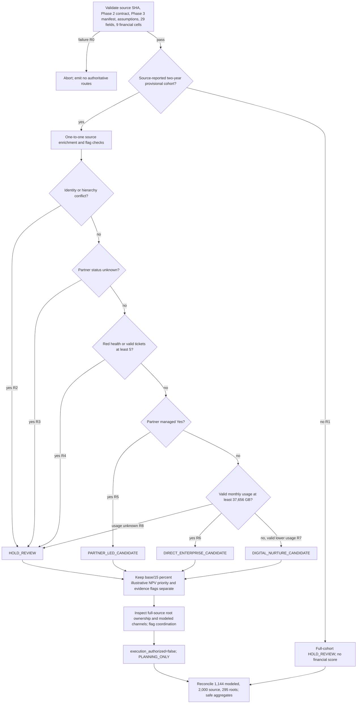

# Phase 4 GTM decision flow

This is the rule order in `gtm_routing.route_account`. It creates planning candidates, never contact instructions. All modeled fiscal eligibility is unconfirmed.

The financial score is a frozen Phase 3 assumption, not an observed propensity or causal uplift. `1 - expected_reactivation_probability` is an **assumed dormancy-persistence proxy** over 12 abstract continuous months. Valid open tickets form a **snapshot backlog proxy**; ticket velocity and historical revenue decay are unobserved. Sentinel 999 and missing tickets remain unknown.
